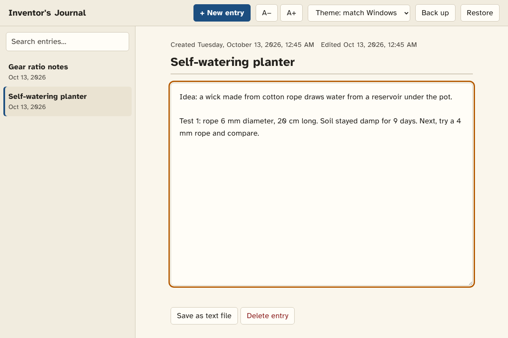

# Inventor's Journal

A private, offline journal for Windows that opens from its own desktop icon.
Its typeface and colours follow published readability and legibility research
(see [Design choices](#design-choices-and-the-research-behind-them)).



## Install (Windows 10 / 11)

1. Download this repository (green **Code** button, then **Download ZIP**) and unzip it.
2. Double-click **`Install.bat`**.
   - If Windows SmartScreen warns you, choose **More info**, then **Run anyway**.
3. An **Inventor's Journal** icon appears on your desktop and in the Start menu.
   To pin it to the taskbar, right-click the icon and choose **Pin to taskbar**
   (on Windows 11, choose **Show more options** first).

The journal opens in its own window. It uses Microsoft Edge, which comes with
Windows, in "app mode", so there is no address bar or tabs. If Edge is
missing, the installer uses Chrome, and if neither is installed it uses your
default browser.

To update the app later, download the new version and run `Install.bat`
again. Your entries are kept. To remove the app, run `Uninstall.bat`. It asks
before deleting any entries.

## Using it

| Action | How |
| --- | --- |
| New entry | **+ New entry** or `Ctrl+N` |
| Search | Type in the search box or press `Ctrl+F` |
| Bigger / smaller text | **A+** / **A−** or `Ctrl+=` / `Ctrl+-` |
| Light / dark theme | Theme menu (it follows the Windows setting by default) |
| Back up everything | **Back up** saves a `.json` file to your Downloads folder |
| Restore a backup | **Restore**, then pick the `.json` file. It merges with your existing entries |
| Export one entry | **Save as text file** |

Each entry is dated when you create it and saved automatically as you type.

**Where are my entries?** They are stored on your PC in
`%LOCALAPPDATA%\InventorsJournal\data`. Nothing is sent over the internet.
Use **Back up** regularly and keep the file somewhere safe, such as OneDrive
or a USB stick.

## Design choices and the research behind them

| Choice | Value used | Research / guideline |
| --- | --- | --- |
| Typeface | **Atkinson Hyperlegible** (bundled), with Verdana and Segoe UI as fallbacks | Designed by the Braille Institute (2019) so that easily confused characters such as `I l 1`, `O 0` and `b d p q` look clearly different. Studies of screen reading, such as Bernard et al. (2001) and Rello & Baeza-Yates (2013), found sans-serif faces like Verdana among the most legible and preferred. |
| Text size | 18 px default, adjustable from 14 to 30 px | Rello, Pielot & Marcos (2016, CHI) found that comprehension and reading improved up to about 18 pt on screen, and that smaller sizes hurt. |
| Line length | At most about 66 characters per line | Bringhurst's *Elements of Typographic Style* recommends 45 to 75 characters, with 66 as ideal. Dyson & Haselgrove (2001) found medium line lengths gave the best comprehension. |
| Line spacing | 1.5 for interface text, 1.6 while writing | WCAG 2.2 success criterion 1.4.12 (Text Spacing) and the British Dyslexia Association (BDA) Dyslexia Style Guide both recommend 1.5. |
| Letter and word spacing | Slightly wider than the font's default | Zorzi et al. (2012, *PNAS*) showed that extra letter spacing improves reading for many readers, especially those with dyslexia. |
| Alignment | Left-aligned, never justified | BDA style guide: justified text creates uneven "rivers" of space. |
| Emphasis | Bold, not italics or underline | BDA style guide. |
| Light colours | Dark warm grey `#23211D` on cream `#FAF6EC` | BDA: use dark text on an off-white or cream background, because pure white can be too dazzling. Contrast is still 14.9:1. |
| Dark colours | Off-white `#E8E3D7` on charcoal `#1C1D20` | Pure white on pure black can make text seem to glow or smear ("halation"), particularly for people with astigmatism. Contrast is 13.2:1. |
| Contrast | Every text and background pair is at least **7:1** | WCAG 2.2 success criterion 1.4.6 (Contrast, Enhanced, level AAA) |
| Accent colour | Deep blue `#1C4E80`, with amber focus rings | Blue and orange stay distinguishable for the common forms of colour blindness. The BDA advises against relying on red and green. |
| Focus | 3 px high-contrast outline | WCAG 2.2 success criterion 2.4.7 (Focus Visible) |

## Project layout

```
app/                 The journal itself (one HTML file, bundled fonts, icon)
Install.bat          Double-click installer (runs Install-Journal.ps1)
Uninstall.bat        Double-click uninstaller (runs Uninstall-Journal.ps1)
tools/make_icon.py   Regenerates app/icon.ico (requires Pillow)
docs/                Screenshots
```

Atkinson Hyperlegible is © 2020 Braille Institute of America, Inc., and is
used under the SIL Open Font License (`app/fonts/OFL-LICENSE.txt`).
